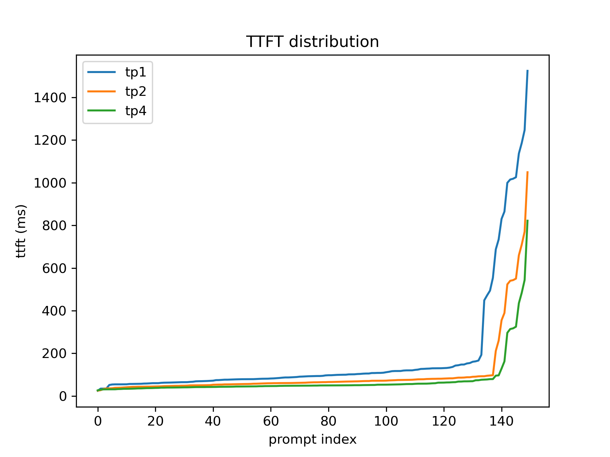
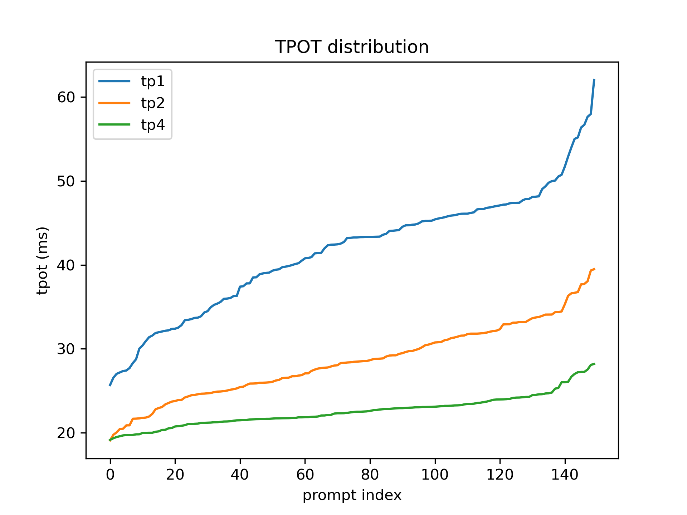

# Report

## TTFT and TPOT

| Configuration | P50 TTFT (ms) | P99 TTFT (ms) | P50 TPOT (ms) | P99 TPOT (ms) |
|---|---:|---:|---:|---:|
| TP1 | 93.29 | 1217.13 | 43.25 | 57.82 |
| TP2 | 64.14 | 740.95 | 28.41 | 38.71 |
| TP4 | 48.93 | 514.54 | 22.44 | 27.81 |

- ttft p99_tp2 / p99_tp1 = $740.95 / 1217.13 = 0.6088$
- ttft p99_tp4 / p99_tp1 = $514.54 / 1217.13 = 0.4227$
- tpot p50_tp4 / p50_tp1 = $22.44 / 43.25 = 0.5188$

## Plots

Here are the distributions of TTFTs and TPOTs (sorted):

