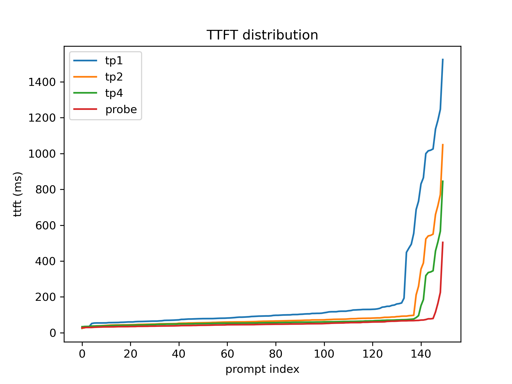
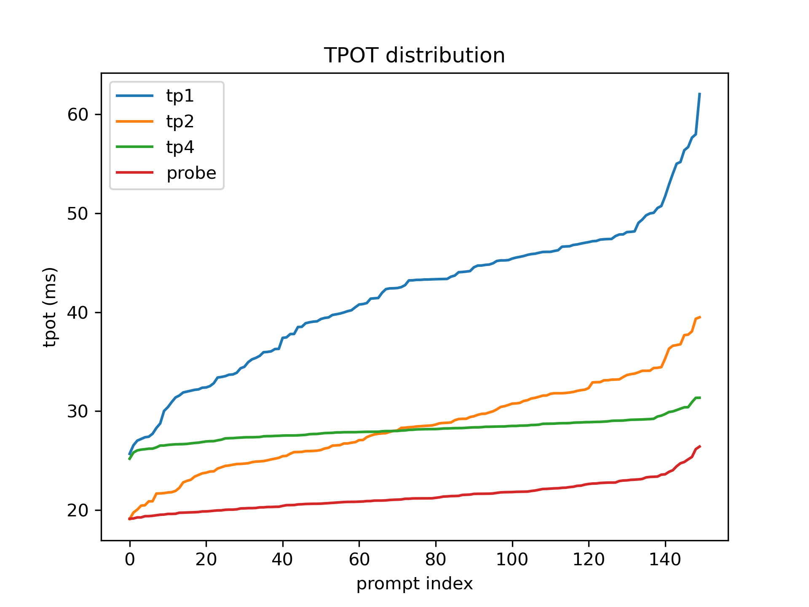
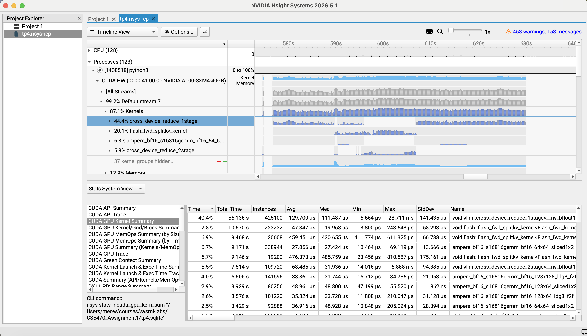

# Report

## TTFT and TPOT

| Configuration | p50 TTFT (ms) | p99 TTFT (ms) | p50 TPOT (ms) | p99 TPOT (ms) |
|---  |---:   |---:     |---:   |---:   |
| TP1 | 93.29 | 1217.13 | 43.25 | 57.82 |
| TP2 | 64.14 | 740.95  | 28.41 | 38.71 |
| TP4 | 48.93 | 514.54  | 22.44 | 27.81 |

- ttft p99_tp2 / p99_tp1 = $740.95 / 1217.13 = 0.6088$
- ttft p99_tp4 / p99_tp1 = $514.54 / 1217.13 = 0.4227$
- tpot p50_tp4 / p50_tp1 = $22.44 / 43.25 = 0.5188$

## Plots

Here are the distributions of TTFTs and TPOTs (sorted):

## Profiling

Top 3 kernels are:

|  Time | Total Time | Instances |        Avg |        Med |       Min |        Max |     StdDev | Name                                      |
| ----: | ---------: | --------: | ---------: | ---------: | --------: | ---------: | ---------: | ----------------------------------------- |
| 40.4% |   55.136 s |    425100 | 129.700 μs | 111.487 μs |  5.664 μs |  28.711 ms | 141.435 μs | `void vllm::cross_device_reduce_1stage`   |
|  7.8% |   10.570 s |    223232 |  47.348 μs |  19.968 μs |  8.800 μs | 243.648 μs |  58.293 μs | `void flash::flash_fwd_splitkv_kernel`    |
|  6.9% |    9.468 s |     20608 | 459.451 μs | 430.655 μs | 411.774 μs | 611.325 μs |  66.789 μs | `void flash::flash_fwd_splitkv_kernel`    |

`cross_device_reduce_1stage` is a AllReduce kernel, and it is also the kernel that takes longest time. The other 2 AllReduce kernels are `void vllm::cross_device_reduce_2stage` and `ncclDevKernel_AllReduce_Sum_f32_RING_LL`. The sum of percentage of all AllReduce operations is $40.4\% + 5.5\% + 0.0\% = 45.9\%$

## Experiment

### Initial analysis

I think H2 should be the bottleneck

#### Why I think H1, H3, H4 are unlikely

- H1: queueing dominates because concurrency is capped
  This is also unlikely, because in the server log files, waiting prompts are always 0.

- H3: the long prompts dominate the tail
  According to task 2's calculation, scaling up even makes the speedup for long prompts ($1/0.4227 = 2.37$ x) greater than that for short prompts ($1/0.6088 = 1.64$ x). So, H3 is also unlikely.
  - ttft p99_tp2 / p99_tp1 = $740.95 / 1217.13 = 0.6088$
  - ttft p99_tp4 / p99_tp1 = $514.54 / 1217.13 = 0.4227$

- H4: the server is under-loaded, so additional GPUs cannot help
  This should not be true, according to the Nsight graph, the 4 GPUs' kernel time occupy 87.1%, 84.8%, 86.5%, 81.6% of kernel + memory time. So, GPUs are busy most of time.

#### H2: prefill chunking is too fine, so prefill is spread over too many scheduler steps

This should cause a huge overhead to scaling up. Because task 4 tells us that `cross_device_reduce` is a hotspot kernel. And hypothesis 2 supports this observation: If we divide the prompt into too many chunks, there will be huge amount of communication among GPUs, making it even slower when we add more GPUs. From the TPOT graph above, we can see that tp4 runs even slower than tp2 for some prompts. This is caused by large amount of communication among GPUs.

### Experiment

To check if this hypothesis correct, I changed `--max-num-batched-tokens` from 512 to 2048, and we get: 

| Configuration | p50 TTFT (ms) | p99 TTFT (ms) | p50 TPOT (ms) | p99 TPOT (ms) | p50 ITL (ms) | p99 ITL (ms) |
|---|---:|---:|---:|---:|---:|---:|
| TP4   | 55.76 | 537.56 | 28.13 | 31.12 | 27.37 | 37.27 |
| Probe | 46.60 | 195.88 | 21.17 | 25.76 | 19.97 | 35.12 |

According to this table and TPOT graph above, we can conclude that H2 is the bottleneck of our 4 GPU configuration. By increasing `--max-num-batched-tokens`, the p99 TTFTs and p99 TPOT of long prompts reduce significantly. Because the number of pieces divided from long prompts reduces, leading to less communication and scheduling. 

But, by profiling, I noticed that my initial guess that `cross_device_reduce` is influenced by H2 is incorrect, its percentage even increase slightly this time. But that is also reasonable, because the amount of AllReduce does not change.
